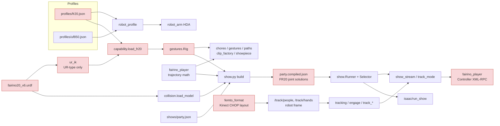
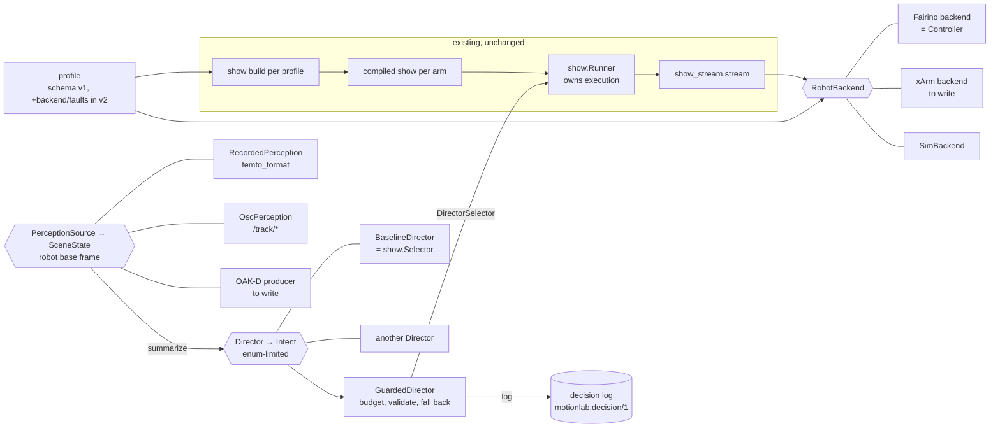

# Coupling audit: what ties this repo to the FR20 and the Femto

Measured on `fr20-urdf-rig` at 3de0a83 (2026-11-04). Every count below is
reproduced by

```bash
python scripts/contracts/coupling_audit.py            # the tables
python scripts/contracts/coupling_audit.py --sites    # every site, file:line
```

which reads the source with `ast` and imports none of it. **The numbers on this
page are a snapshot of 2026-11-04; the script is the source of truth.** Rerun
it before trusting one, and after any merge that adds code — the open
`review-loop` PR, for one, adds `scripts/review_render.py`, which imports
`fairino_player.Path` and hard-codes `"fr20"` (`RP.load`, `M._tcp_path`,
`M.from_csv`); whichever of the two merges second should refresh the counts.

The question this page answers: **to put a UF850 / xArm, or an OAK-D, under
the existing show, what has to change, and where should each change live?**
Every coupling is sorted into one of three places it belongs:

| Category | Belongs in | Today |
|---|---|---|
| **A. Kinematics** — what the arm *is*: limits, geometry, IK, home, tool | the **profile** (`profiles/<id>.json`) and what reads it | partly profile-driven (the HDA, `robot_profile.py`), partly hard-coded `"fr20"` in the Python generators and checks |
| **B. Drivers** — how to *move* the arm / *read* the camera | a **backend** (`RobotBackend`) / a **source** (`PerceptionSource`) | `fairino_player.Controller` imported directly; the Femto's channel layout read directly |
| **C. Show configuration** — what *this show* plays where | `shows/<name>.json` and its build | the show config names no robot; its hub poses and its compiled clips are FR20 joint solutions |

## Summary

| What | Count | Of which |
|---|---|---|
| Files importing `fairino_player` | **23** | **8** for the driver (`Controller` & co), **15** for trajectory math only (`limiting`, `need_profile`, `load_csv`, `Path`, `condition`) |
| `"fr20"` string constants | **165** in **54** files | **111** in code paths, 12 default parameters, 2 CLI defaults, 40 in tests |
| … passed to `collision.load_model("fr20")` | 38 | the collision model: capsules from the FR20 URDF + the tool |
| … passed to `robot_profile.load("fr20")` | 25 | limits, home, velocity / acceleration |
| … passed to `motion_clip._tcp_path("fr20", …)` | 11 | TCP by URDF FK |
| … defaults `def f(…, robot="fr20")` | 12 | `show.py` tool / strip / facing helpers, `collision`, `fairino_player.move_plan`, Isaac |
| … `clip.get("robot", "fr20")` and clips written with `"robot": "fr20"` | 7 + 6 | the clip's own `robot` field ignored or fixed |
| … Isaac `SingleArticulation(name="fr20")`, Houdini node names | 6 + 7 | naming only |
| `capability.load_fr20()` callers | 6 | `choreo`, `gestures.Rig`, `clip_factory`, `capability`, `atlas_check`, `atlas_sop` |
| `gestures.Rig()` users (FR20 via `load_fr20`) | 10 | `show`, `show_rig`, `paths`, `showpiece`, `transitions`, `engage`, `tracking`, `track_eval`, `render_clip_review`, `isaac/run_tracking` |
| `ur_ik` users (UR-type closed form only) | 8 | `capability`, `choreo`, `clip_factory`, `gestures`, `motion_clip`, `retarget`, `show`, `hda/robot_arm_module` |
| `femto_format` importers (Kinect Azure CHOP layout) | 5 | `mocap_cmu`, `mocap_scenes`, `track_replay`, `track_sim`, `track_test` |
| `/track/people` + `/track/hands` users (robot frame — already camera-neutral) | 8 | the seam to keep |
| `/track/target` + `/track/lost` users (the 09-28 OAK-D proposal) | 5 | `tracking.TargetInput`, `track_sim`, `track_eval`, `track_runner`, `isaac/run_tracking` |

**What is already decoupled** (and the reason the port is feasible at all):

- `robot_profile.py` owns every frame conversion; the HDA reads limits, axes,
  signs and presets from the profile as expressions (`scripts/hda/robot_arm_module.py`).
- `ur_ik.py` derives its solve from the URDF's zero-pose geometry (no DH table)
  and refuses a non-UR arm with a named reason (`ur_ik.analyse` → `NotURType`).
- `show_stream.stream(ctrl, link, runner, …)` takes the controller as a
  parameter and calls ten methods on it; its own self-test drives it with a
  fake (`FakeCtrl`). `fairino_player.Controller` already *is* a backend; nobody
  named the interface. (`scripts/contracts/robot.py` now does; conformance
  checks `Controller` satisfies it.)
- `show.Runner` is backend-agnostic: the same `step(dt)` runs on a dry clock,
  in Isaac (`isaac/run_show.py`) and in the stream.
- `/track/people` and `/track/hands` are in the **robot base frame**:
  `femto_format.messages` applies the extrinsic before anything downstream
  sees a point. Every consumer of those messages is already camera-neutral.
- The clip schema (`motionlab.clip/1`) carries `robot`, `joint_names` and `units`.

## A. Kinematics → the profile

The Python side of the toolchain (generators, checks, the show build, the
tracking layer) assumes the FR20 in three ways.

**A1. `"fr20"` as a literal profile id (111 code sites).** The heaviest:

| Site pattern | Count | Where | Change |
|---|---|---|---|
| `C.load_model("fr20")` | 38 | `show.py` (build, cues, scan), `gestures.py` (8), `safe_move.route`, `tracking`, `transitions`, `paths`, `track_*`, `probe_*`, Isaac | take the profile id from the show / the caller |
| `RP.load("fr20")` | 25 | `show.build` (show.py:524), `choreo` (module-level `HOME`, choreo.py:132), `engage`, `tracking`, `safe_move`, `clip_factory`, `show_stream.main` | same |
| `M._tcp_path("fr20", …)` | 11 | `choreo` (4), `show` (2), `clip_factory`, `gestures`, `paths`, `retarget`, `render_real_compare` | pass the clip's own `robot` |
| default `robot="fr20"` | 12 | `show.watched_points / tool_pose / facing / strip_face / strip_ends / paper_light / motion_stats`, `collision.load_model`, `fairino_player.move_plan`, `isaac_stage`, `led_viz`, `accel_probe` | harmless while one arm exists; becomes wrong silently with two — remove the default when a second profile is used |
| `clip.get("robot", "fr20")`, `"robot": "fr20"` written | 13 | `clip_library`, `stage_set`, `play`, `play_ui`; `choreo`, `clip_factory`, `gestures`, `paths`, `retarget`, `show` | write the profile used; refuse a clip whose `robot` ≠ the profile played |

**A2. `capability.load_fr20()` and `gestures.Rig`** — the generators' rig object
(chain, flange offset, IK, limits) is built from `profiles/fr20.json` by name,
then shared by 10 modules. One function to generalise (`load_rig(profile_id)`)
removes most of A1 in the generators.

**A3. UR-type IK assumed.** `gestures.Rig.solve/track`, `choreo`, `clip_factory`,
`show.build`, `capability` solve with `ur_ik`, which only accepts arms whose
J2, J3, J4 are parallel. The FR20 is; **the UF850 and the xArm are not** (a
J4 forearm roll — the UF850 profile's own `rotation_axis` reads `["y","z","z","y","z","y"]`,
J4 along the bone). On the UF850 `ur_ik.analyse` will raise
`NotURType("… J2 parallel to J4 fails")` — *to confirm once a UF850 URDF is in
`assets/`; there is none yet*. The HDA's FBIK path still works (mm-level error,
J4 limit not enforced — `uf850.json` `_comment_fbik`), but no Python generator
can make a clip for it. This is the largest single gap; see
[porting.md](../porting.md#3-ik-solver) and [ADR 005](../adr/005-clips-are-solved-per-arm.md).

**A4. FR20 facts in code, not the profile.**

- `show_stream.SINGULAR_POSE = 10` and `recover()` — the FR20's singular-pose
  stop and the J5-crosses-0 test (`a[4] < 0`); `show.wrist_singular_report`
  (J5 = 0 is the FR20 wrist singularity; other wrists differ).
- `gestures.REACH_M = 1.6` and `gestures.SHOULDER` (the FR20's reach and
  shoulder point, hard-coded), and the show config's `range` (`j1_deg`,
  `tcp_z`, read by `show.out_of_range`) chosen for this arm's workspace.
- `choreo.HOME` falls back to a hard-coded FR20 home list.
- The tool lives in `profiles/fr20.json` (`tool.urdf: uv_bar.urdf`,
  `cable_j6_deg`), so the UV bar is part of "the FR20". On another arm the
  same bar would be copied into another profile. The tool belongs to the cell
  or the show, and its cable range to the (arm, tool) pair.

## B. Drivers → a backend / a source

### B1. The arm: `fairino_player`

`fairino_player.py` is two modules in one file, and its importers split cleanly:

| Used for | Files | Symbols |
|---|---|---|
| **Driver** (8) | `show_stream`, `track_mode`, `track_test`, `accel_probe`, `show_ui`, `track_ui`, `play`, `play_ui` | `Controller`, `move_checked`, `move_plan`, `run_path`, `_require_no_error`, `SIM_NET`, `RPC_TIMEOUT_S`, `play`, `main` |
| **Trajectory math only** (15) | `motion_clip`, `show`, `choreo`, `gestures`, `paths`, `clip_factory`, `retime_topp`, `retarget`, `showpiece`, `show_rig`, `cell_sop`, `roundtrip_check`, `render_real_compare`, `callbacks/ctrl_retime`, `hda/csvio_module` | `limiting`, `need_profile`, `condition`, `Path`, `load_csv`, `_peaks`, `TrajectoryError` |

The 15 are not a driver coupling — PCHIP conditioning and envelope fitting
are arm-neutral — but they live in the driver's file, so any change to the
driver touches the generators' imports, and a UF850 player would either
import the Fairino file for its math or fork it. Splitting the math into
`scripts/trajectory.py` (with `fairino_player` re-exporting it, so no
importer changes) is [migration step 2](migration.md); [ADR 006](../adr/006-split-trajectory-math-from-fairino-driver.md).

FR20-specific driver facts that a backend must own instead:

| Fact | Where now | Belongs |
|---|---|---|
| XML-RPC port 20003, `ServoJ` / `MoveJ` / `GetForwardKin` signatures | `fairino_player.Controller` | the Fairino backend |
| SimMachine subnet `192.168.116.` | `fairino_player.SIM_NET`, read by `show_stream`, `show_ui`, `track_ui` | the backend's "is this a simulator" check |
| `RPC_TIMEOUT_S`, `MOVE_TIMEOUT_S`, no timeout on the sender (Windows stalls) | `fairino_player` | the backend's factory (`command()` / `feedback()`) |
| `MOVE_ERRORS` (14, 154), `SINGULAR_POSE = 10`, `RECOVER_MAX` | `fairino_player`, `show_stream` | `BackendInfo.faults` |
| The model string must contain `"FR20"` | `fairino_player.main` | the Robot contract (`model()` names the profile) |
| 125 Hz, `playback_ppm` (the FR20's ServoJ clock runs ~950 ppm slow), lag correction | `show_stream`, `playback.toml` | per backend + per controller (measured), not per show |
| `_current_frames` (MoveJ needs the applied tool / workpiece) | `fairino_player` | the Fairino backend |

### B2. The camera: `femto_format`

| Layer | Camera-specific? | Files |
|---|---|---|
| Kinect Azure CHOP channel names (`p1/head:tx`, 32 joints, confidence levels), 30 fps, TD's zero timestamps | **yes** | `femto_format` + its 5 importers (`mocap_cmu`, `mocap_scenes`, `track_replay`, `track_sim`, `track_test`) |
| "head = person, higher wrist = hand" | body-tracker-specific (needs a skeleton) | `femto_format.messages` |
| Extrinsic `{R, p}` and `solve_extrinsic` (Kabsch on floor marks) | the math is neutral; the file is named `femto_extrinsic.json` | 4 files find it by that name |
| `/track/people`, `/track/hands` in the robot base frame | **no** — the seam | 8 files |
| `/track/target`, `/track/lost` (single target, the OAK-D proposal of 09-28) | no, but a second message family for the same thing | 5 files (`tracking.TargetInput`, `track_sim` scenarios, `track_eval`) |

An OAK-D enters at the seam: a process that turns DepthAI detections into
`SceneState` (= `/track/people` + `/track/hands`) with its own extrinsic.
Nothing downstream of `femto_format.messages` changes. Two decisions are open
there: whether an OAK-D without full body tracking can supply "hands"
(a palm detector, or none — `SceneSummary.hands_up` would read 0), and
whether `/track/target` is retired in favour of `/track/people`
(`tracking.Attention` already chooses one person from `/track/people`).

## C. Show configuration

| Item | Arm-neutral? | Notes |
|---|---|---|
| `shows/party.json`: no `robot` field | — | `show.build` loads `"fr20"` (show.py:524) |
| hubs given as `tcp` + `look` (greet, low, high) | **yes** (Cartesian) | re-solved per arm at build |
| hubs given as `q` (rest), and every hub's `near` IK seed | **no** — FR20 joint values | `rest.q = [-60, -90, 90, -90, -90, -15]` |
| `zones`, `stage`, `canvas`, `scan` (speed, passes, accel), `select` (arc, no_repeat, hub_stay), `sequences`, `families` | **yes** | the show's intent |
| `shows/*.compiled.json` segments (`t`, `q`), hub poses, `clearance_m` | **no** — one arm's solution | rebuilt per arm (ADR 005) |
| `labels` (action, effort, intent, bpm, family; energy is ranked within the library) | **mostly** — energy and stats are measured from this arm's motion | |
| `envs/*.usda` room, obstacles, zones | yes, except the controller work area and where the base stands | |
| `playback.toml` (`playback_ppm` per IP, profile `fr20`) | no — per controller | |
| Houdini scenes `FR20_*.hiplc`, nodes `/obj/fr20*`, Isaac `/World/fr20`, `fr20_usd` | names only | rename when a second arm shares a scene |
| `show_rig.py` warns "the show generator and its checks are made for the FR20" when the profile is not `fr20` | — | honest today |

## Dependency graph

Today (arrows: "imports / reads"; red: FR20- or Femto-specific):



Target (what the contracts introduce; nothing in the box "existing" changes
until a [migration step](migration.md) says so):


